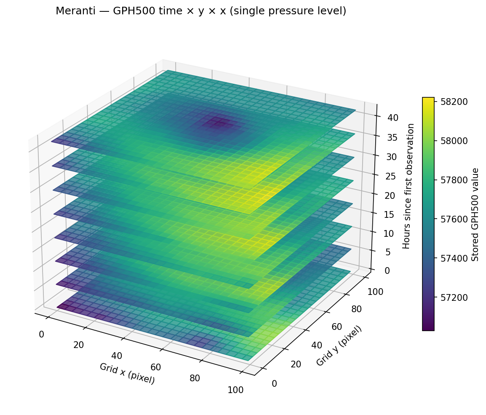
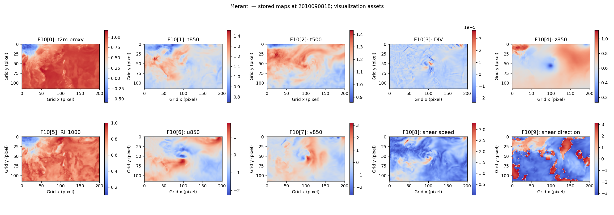

# Learning at Different Speed — TAER-MoE Demo

This repository provides a runnable demonstration of TAER-MoE, including the model and training code, a packaged checkpoint, a small tropical cyclone test sample, and data visualization code with example outputs. You can run the demo to inspect the data, try the evaluation pipeline, and check that the included components work together.

**This is a sample release. We plan to release the full dataset in a subsequent update.** The current package includes only the demonstration test data; training and validation data are not included.

## Included files

All runnable components are in `TAER_MoE_minimal/`:

| File or directory | Purpose |
| --- | --- |
| `train.py` | Single training entry; epoch-based training with optional input acceleration and progress logging |
| `paper_pipeline.py`, `taer_feedback.py` | Training objective, expert-task statistics, and routing feedback |
| `test.py` | Single evaluation entry; automatically detects the new or bundled checkpoint format |
| `meta.py`, `meta_legacy.py`, `meta_ensemble.py` | Build deterministic-mixture or expert Best-of-K combined checkpoints |
| `visualize.py` | Generate the four data visualization outputs |
| `TCNM/` | Model architectures, data loaders, losses, and utilities |
| `install.sh` | Python dependency installation |
| `ckpt.pt` | Supplied seed-200 expert Best-of-K checkpoint, stored with Git LFS |
| `seed3047ckpt.pt` | Optional historical checkpoint, also supported by `test.py` |
| `data_demo/` | MERANTI (2010), WP test example and its required data assets |
| `visualizations/` | One CSV table and three PNG figures |

## Installation

The demo was checked with **Python 3.8.5**, PyTorch 1.11.0, NumPy 1.24.3, OpenCV headless 4.12.0.88, and Matplotlib 3.7.5 on Linux. Use Python 3.8 for the pinned dependencies in `install.sh`.

Install Git and Git LFS, then download the repository and checkpoint:

```bash
git lfs install
GIT_LFS_SKIP_SMUDGE=1 git clone https://github.com/anonymous-learning-ICLR/learning-at-different-speed.git
cd learning-at-different-speed
git lfs pull --include="TAER_MoE_minimal/ckpt.pt"
```

Create an environment and install the Python dependencies:

```bash
conda create -n taer-demo python=3.8 -y
conda activate taer-demo
cd TAER_MoE_minimal
bash install.sh
```

The supplied `ckpt.pt` is **228,045,877 bytes** (approximately **218 MiB**). If it is only a small text file, repeat the Git LFS pull command above. Its SHA-256 is `e9f0298da5843e915408ec865f8b36bd6328314dd090af489b242fea75fd7804`.

All commands below run from `TAER_MoE_minimal/`.

## Run the evaluation demo

No training is required. The included checkpoint can be evaluated on CPU:

```bash
python test.py \
  --checkpoint ckpt.pt \
  --data-dir data_demo \
  --areas WP \
  --device cpu \
  --threads 4 \
  --workers 0 \
  --output demo_results
```

With a compatible CUDA installation, replace `--device cpu` with `--device cuda --gpu_num 0`.

The script prints only the result tables during a successful evaluation and writes the same tables to `demo_results/summary.txt`. Each table contains overall ADE and FDE, per-step TDE, pressure and wind errors, and an AVG row. Track errors are in km, pressure errors in hPa, and wind errors in m/s.

The demo contains **one evaluation window**: eight observed records followed by four future records from MERANTI in the WP basin. Its `Area: ALL (N=1)` and `Area: WP (N=1)` tables are identical. This example checks that the checkpoint, data and test code work together; it does not represent the full test dataset. Successful testing prints only tables, without initialization messages, checkpoint lists or a running notice.

The supplied checkpoint embeds ten seed-200 model states and their saved per-area fusion coefficients. Each model samples 20 expert indices with replacement using its saved track router, then uses the true future XY to select one whole trajectory, including that expert's pressure and wind predictions. There are six deterministic experts and no latent-noise layer, so there are at most six distinct candidate trajectories per model. This adapts the historical Best-of-K procedure to the current architecture; it does not recreate the historical noisy model. Fusion coefficients were fitted on test labels. The resulting oracle scores are not an independent held-out benchmark or forecasts made without access to future labels. `test.py` loads the saved rules and never refits them.

With separately obtained full test data, run:

```bash
CUDA_VISIBLE_DEVICES=0 python -u test.py \
  --checkpoint ckpt.pt \
  --data-root /path/to/TropiCycloneNet1 \
  --areas EP NA NI SI SP WP \
  --device cuda --batch-size 64 --threads 4 --io-workers 2 \
  --output test_report
```

This prints `Area: ALL (N=...)` followed by EP, NA, NI, SI, SP and WP, and saves the same tables to `test_report/summary.txt`. The full test dataset is not bundled. Original member checkpoint files and training/validation data are not required. Optional `--progress-log test_report/progress.log` writes progress to a separate file without adding terminal messages.

CPU and CUDA runs can give different candidate selections and scores. For numerical comparisons, keep the device/backend, PyTorch version and batch size the same as the reference run. The release and original research code were checked to produce identical NI test-subset tables on CPU with the supplied checkpoint.

## Visualize the example

Visualization runs on CPU and does not require loading the checkpoint:

```bash
python visualize.py --data-dir data_demo --output visualizations
```

This writes exactly four files:

| Output | Contents |
| --- | --- |
| [data_1d.csv](TAER_MoE_minimal/visualizations/data_1d.csv) | Readable table of UTC timestamps, observed/future roles, longitude, latitude, pressure, and wind |
| [environment_3d.png](TAER_MoE_minimal/visualizations/environment_3d.png) | Stacked GPH500 maps over observation time |
| [features6.png](TAER_MoE_minimal/visualizations/features6.png) | Six-channel feature maps |
| [features10.png](TAER_MoE_minimal/visualizations/features10.png) | Ten-channel feature maps |

The environmental figure uses **time × grid y × grid x** at a single pressure level; its third axis is time. Feature figures display the stored map values. Open the CSV in a spreadsheet application to inspect the 1D data.

### Example figures






## Training code and completeness checks

`train.py` is the only training entry, and `test.py` is the only evaluation entry. The model, data loader, losses, expert-task statistics, and feedback controller are included. Inspect its options with:

```bash
python train.py --help
```

Training requires separately authorized training and validation data. The bundled test example is intended for evaluation and visualization and is insufficient for training. `--data-root` is the parent of the following folders:

```text
TropiCycloneNet1/
  bst_divi10_train_val_test_inlcude15_2023_new/<AREA>/{train,val,test}/*.txt
  all_area_correct_location_includeunder15_2023/
  all_ocean_gph500_2023/
  features6/
  features10/
```

Preserve the environmental assets' basin/year/storm/timestamp organization. Run on GPU 0:

```bash
CUDA_VISIBLE_DEVICES=0 python -u train.py \
  --data-root /path/to/TropiCycloneNet1 \
  --output-dir ./runs/full_seed3407_tc3_inputs \
  --variant full \
  --seed 3407 \
  --device cuda \
  --areas EP NA NI SI SP WP \
  --epochs 100 \
  --batch-size 16 \
  --workers 0 \
  --threads 2 \
  --feature-mode legacy \
  --feature-reduction none \
  --split-policy existing
```

Keep the explicit seed and batch size in this command, since the parser's generic defaults differ. Each epoch traverses the full training loader, including the final partial batch. After each epoch, the controller collects training and validation expert-task errors, computes routing corrections, and applies them through `set_feedback()` before evaluating and saving the updated state.

`--feature-mode legacy --feature-reduction none` retains the original Feature 6/10 handling: `timestamp.npy` lookup, original storm-name fallback, zero/partial-load fallback, and no spatial pooling. Files with `_features6.npy` or `_features10.npy` suffixes are ignored by this mode. The visualization code displays the stored maps independently of this training lookup.

The run directory contains `last.pt` after each completed epoch, `best.pt` when validation ADE improves, `feedback.jsonl`, the configuration, and the split manifest. Resume in the same output directory by adding `--resume ./runs/full_seed3407_tc3_inputs/last.pt`. Source hashes and the split manifest are checked on resume. A narrowly scoped compatibility check also accepts checkpoints from the original epoch driver before its entry files were consolidated. This driver saves at epoch boundaries.

For optional input acceleration and progress logging, keep the same `train.py` command and append:

```text
--io-workers 1 --prefetch-factor 2 --cache-frames 4096 --pin-memory --log-every 50
```

This adds ordered input prefetching, caching, pinned transfers, and `OUTPUT_DIR/out.log` without changing the training loop or its configuration. Use a fresh output directory or explicitly resume an existing run.

Evaluate a newly trained checkpoint with:

```bash
CUDA_VISIBLE_DEVICES=0 python test.py \
  --checkpoint ./runs/full_seed3407_tc3_inputs/best.pt \
  --data-root /path/to/TropiCycloneNet1 \
  --device cuda \
  --output ./runs/full_seed3407_tc3_inputs/test_metrics.json
```

`test.py` detects the new `taer-paper-reconstruction-v1` format and keeps its saved routing feedback fixed. It prints and saves aggregate metrics as JSON. By default, it requires train/validation/test folders to audit split overlap. `--demo-only` skips that audit for test-only demonstrations but still requires test data for the selected areas. By default these are all areas configured in the checkpoint; `--areas WP` can restrict a demo to WP when that basin is in the saved configuration.

The historical `seed3047ckpt.pt` retains its original format and remains supported. To use it, download it with `git lfs pull --include="TAER_MoE_minimal/seed3047ckpt.pt"` from the repository root, then pass `--checkpoint seed3047ckpt.pt` to `test.py`. The evaluator selects the architecture and loading path automatically; the checkpoint formats remain distinct. For combined checkpoints, `--output` names a directory containing `summary.txt`; for a single epoch-model checkpoint, it names a JSON file. Only the necessary legacy architecture defaults are retained in the evaluator; there is no separate legacy training entry. No private training or validation data is included.

Run the implementation checks from `TAER_MoE_minimal/`:

```bash
python -m unittest discover -s tests -v
```

These cover routing feedback, expert-task statistics, data handling, model gradients, saving/resuming training, evaluation, and input-pipeline consistency. Full training requires the separately authorized data.

## Build and test a combined checkpoint

`meta.py` combines checkpoints from the current epoch-model architecture. It reads the numbered `checkpoint_with_model_*.pt` snapshots plus `best.pt` and `last.pt`, freezes their contents at startup, and removes exact duplicate model states. It does not modify those files or wait for an ongoing training run to finish. The resulting `ckpt.pt` includes all member parameters, saved routing buffers, input settings, and per-area fusion coefficients. Original checkpoint paths are not required for testing.

For each basin, longitude and latitude use nonnegative linear regression without an intercept; pressure and wind use Ridge regression with `alpha=1.0`, matching the historical fusion recipe. The current model produces deterministic task/expert mixtures, so the old architecture's ground-truth Best-of-K selection is not used. This is a prediction ensemble stored in one file, not an average of network parameters.

To explicitly reproduce the historical **test-fit/test-evaluation** protocol:

```bash
CUDA_VISIBLE_DEVICES=0 python -u meta.py \
  --checkpoint-dir /path/to/runs/full_seed200_bs64_ep101 \
  --data-root /path/to/TropiCycloneNet1 \
  --output ./runs/seed200_combined/ckpt.pt \
  --fit-split test \
  --areas EP NA NI SI SP WP \
  --device cuda --batch-size 64 --threads 2 --io-workers 2
```

This protocol fits coefficients using test labels, so the reported errors are not independent held-out test estimates. The checkpoint records this choice. For separate calibration, use `--fit-split val` instead; this is the default when the option is omitted. Fitting checks the existing train/val/test split manifests. Scikit-learn and SciPy are needed for fitting and are included in `install.sh`; inference applies the stored coefficients without either package.

Test using only the combined checkpoint and evaluation data. The combined-checkpoint test is integrated into the existing `test.py` entry:

```bash
CUDA_VISIBLE_DEVICES=0 python -u test.py \
  --ckpt_path ./runs/seed200_combined/ckpt.pt \
  --data_root /path/to/TropiCycloneNet1 \
  --areas EP NA NI SI SP WP \
  --device cuda --batch_size 64 --threads 4 --io-workers 2 \
  --output_dir ./runs/seed200_combined/eval_report
```

For CPU execution, use `--device cpu`. Testing never fits new coefficients or updates routing feedback. It prints only `Area: ALL (N=...)` and the EP, NA, NI, SI, SP, WP tables, with ADE/FDE, per-step TDE/pressure/wind errors, and AVG. `eval_report/summary.txt` contains the same tables. ALL aggregates actual windows and valid timesteps across the selected basins. Optional `--progress-log /path/to/progress.log` writes progress separately without adding console messages.

For combined checkpoints, omitting `--output_dir` saves the tables to `./test_report/summary.txt`. Batch size, CPU thread count, input-reader count, and cache capacity default to the saved evaluation settings; explicit options override them. `--workers` is also accepted as an alias for `--io-workers` for this format, with `0` selecting serial loading. `--checkpoint`, `--data-root`, `--batch-size`, and `--output` remain supported aliases. Only test data for the selected basins is required; original member checkpoint files and training/validation data are not needed.

The combined checkpoint has format `taer-paper-meta-ensemble-v1`; `test.py` detects it automatically alongside the two previously supported formats. New training snapshots require a new fusion build to be included. Existing output checkpoint files are not overwritten.

To build the expert Best-of-K format used by the supplied `ckpt.pt`, run:

```bash
CUDA_VISIBLE_DEVICES=0 python -u meta_legacy.py \
  --checkpoint-dir /path/to/runs/full_seed200_bs64_ep101 \
  --data-root /path/to/TropiCycloneNet1 \
  --output ./runs/seed200_bestof20/ckpt.pt \
  --fit-split test --num-samples 20 \
  --areas EP NA NI SI SP WP \
  --device cuda --batch-size 64 --threads 4 --io-workers 2
```

This format is `taer-paper-expert-bestofk-meta-v1`. The same `test.py` reads its saved candidate count, seed, routing buffers and fusion coefficients automatically. Even with `--fit-split val`, Best-of-K candidate selection still uses test labels during evaluation, so these remain oracle scores. The builder preserves the trained weights and does not add a noise layer.

## Planned data release

We plan to make the full dataset available in a subsequent release and update this README with download links, data preparation instructions, and commands for full-dataset experiments.

