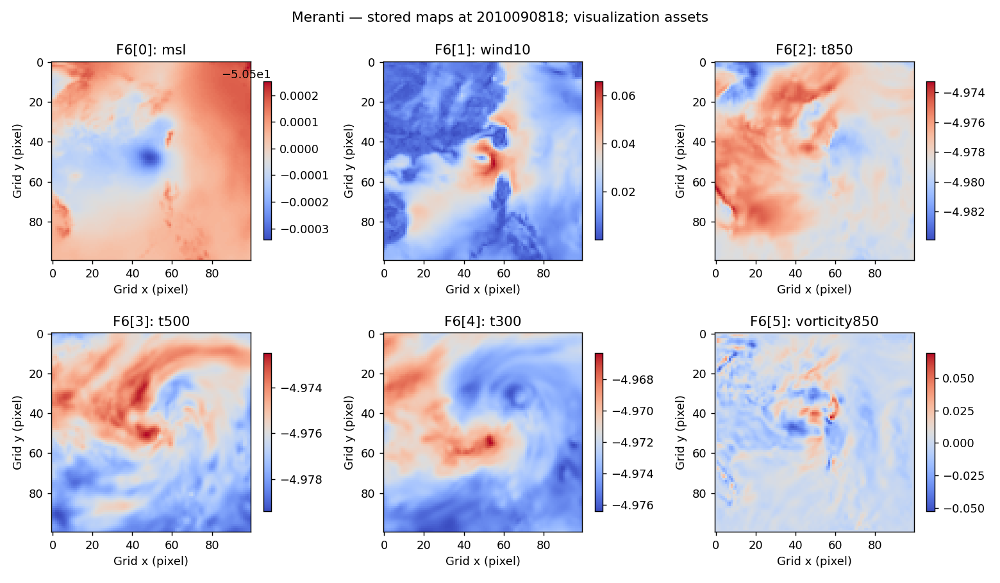

# Learning at Different Speed — TAER-MoE Demo

This repository provides a runnable demonstration of TAER-MoE, including the model and training code, a packaged checkpoint, a small tropical cyclone test sample, and data visualization code with example outputs. You can run the demo to inspect the data, try the evaluation pipeline, and check that the included components work together.

**This is a sample release. We plan to release the full dataset in a subsequent update.** The current package includes only the demonstration test data; training and validation data are not included.

## Included files

All runnable components are in `TAER_MoE_minimal/`:

| File or directory | Purpose |
| --- | --- |
| `train.py` | Training entry point; requires separate training and validation data |
| `evaluate.py` | Load the checkpoint and print evaluation tables |
| `visualize.py` | Generate the four data visualization outputs |
| `TCNM/` | Model architectures, data loaders, losses, and utilities |
| `install.sh` | Python dependency installation |
| `seed3047ckpt.pt` | Packaged checkpoint, stored with Git LFS |
| `data_demo/` | MERANTI (2010), WP test example and its required data assets |
| `visualizations/` | One CSV table and three PNG figures |

## Installation

The demo was checked with **Python 3.8.5**, PyTorch 1.11.0, NumPy 1.24.3, OpenCV headless 4.12.0.88, and Matplotlib 3.7.5 on Linux. Use Python 3.8 for the pinned dependencies in `install.sh`.

Install Git and Git LFS, then download the repository and checkpoint:

```bash
git lfs install
git clone https://github.com/anonymous-learning-ICLR/learning-at-different-speed.git
cd learning-at-different-speed
git lfs pull
```

Create an environment and install the Python dependencies:

```bash
conda create -n taer-demo python=3.8 -y
conda activate taer-demo
cd TAER_MoE_minimal
bash install.sh
```

The checkpoint should be approximately **276 MiB**. If it is only a small text file, run `git lfs pull` to download the actual weights.

All commands below run from `TAER_MoE_minimal/`.

## Run the evaluation demo

No training is required. The included checkpoint can be evaluated on CPU:

```bash
python evaluate.py \
  --checkpoint seed3047ckpt.pt \
  --data-dir data_demo \
  --areas WP \
  --device cpu \
  --threads 4 \
  --workers 0 \
  --output demo_results
```

With a compatible CUDA installation, replace `--device cpu` with `--device cuda --gpu_num 0`.

The script prints only the result tables during a successful evaluation and writes the same tables to `demo_results/summary.txt`. Each table contains overall ADE and FDE, per-step TDE, pressure and wind errors, and an AVG row. Track errors are in km, pressure errors in hPa, and wind errors in m/s.

The demo contains **one evaluation window**: eight observed records followed by four future records from MERANTI in the WP basin. Therefore, its `Area: ALL` and `Area: WP` tables are identical. A CPU check with the bundled defaults produced:

| Demo metric | Value |
| --- | ---: |
| Overall ADE (km) | 29.394611 |
| Overall FDE (km) | 37.714573 |
| Average pressure error (hPa) | 7.7907 |
| Average wind error (m/s) | 5.2079 |

These numbers describe the bundled example, not the full test dataset. Small numerical differences can occur across environments.

The checkpoint contains multiple model parameter sets and their saved fusion coefficients in a single file. Evaluation uses the saved settings, including ground-truth Best-of-K candidate selection. The historical fusion coefficients were fitted on test data; these demo results should not be interpreted as an independent held-out benchmark or as forecasts made without access to future labels.

## Visualize the example

Visualization runs on CPU and does not require loading the checkpoint:

```bash
python visualize.py --data-dir data_demo --output visualizations
```

This writes exactly four files:

| Output | Contents |
| --- | --- |
| [data_1d.csv](TAER_MoE_minimal/visualizations/data_1d.csv) | Readable table of UTC timestamps, observed/future roles, longitude, latitude, pressure, and wind |
| [environment_3d.png](TAER_MoE_minimal/visualizations/environment_3d.png) | Stacked GPH500 maps over observation time |
| [features6.png](TAER_MoE_minimal/visualizations/features6.png) | Six-channel feature maps |
| [features10.png](TAER_MoE_minimal/visualizations/features10.png) | Ten-channel feature maps |

The environmental figure uses **time × grid y × grid x** at a single pressure level; its third axis is time. Feature figures display the stored map values. Open the CSV in a spreadsheet application to inspect the 1D data.

### Example figures





## Training code and completeness checks

The training entry point and its local dependencies are included. Inspect its options with:

```bash
python train.py --help
```

Training requires the full data layout, including separate `train` and `val` splits and their corresponding environmental assets. The bundled test example is intended for evaluation and visualization, and is insufficient for training.

The sample release was checked by parsing all 12 Python files, loading the training command's help, evaluating the supplied checkpoint on the demo, and regenerating the four visualization files. Full training and full-dataset evaluation are not covered by this demo check.

## Planned data release

We plan to make the full dataset available in a subsequent release and update this README with download links, data preparation instructions, and commands for full-dataset experiments.

